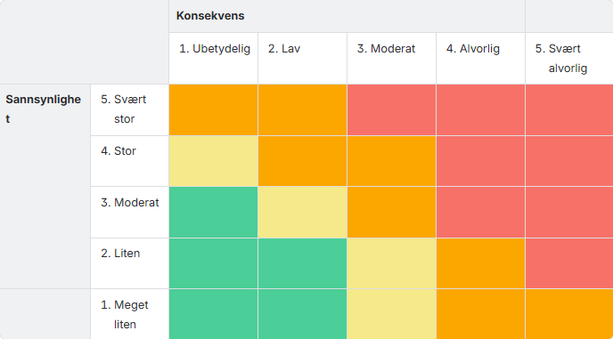

Risikoer ved ett sky-basert helpdesk system.

Dette er en ros analyse hvor vi finner risikoer ved ett sky-basert helpdesk system.

I denne ROS analysen bruker vi 5-Punktskala for sannsynlighet og konsekvens på linje som SSB for å holde oss i tråd med dem.

Sannsynelighet
-
Meget liten
Mindre enn 10 % sannsynlig og/eller inntreffer hvert 5. år eller sjeldnere
Verdi 1-2  i risikomatrisen

Liten
10-30 % sannsynlig og/eller inntreffer hvert år eller sjeldnere
Verdi 3-4 i risikomatrisen

Moderat
30-60 % sannsynlig og/eller inntreffer 2-4 ganger per år
Verdi 5-9 i risikomatrisen

Stor
60-90 % sannsynlig og/eller inntreffer månedlig
Verdi 10-15 i risikomatrisen

Svært stor
Over 90 % sannsynlig og/eller inntreffer ukentlig
Verdi 16-25 i risikomatrisen

Konsekvens
-

1. Ubetydelig
2. Lav
3. Moderat
4. Alvorlig
5. Svært Alvorlig

Risiko - Verdien for kosekvens (X) og sannsynelighet (Y) multipliseres med hverandre (X * Y = A)

--

Under her skal jeg gå gjennom risikoer, utdype dem og konsekvenser.
---
Ved helpdesk system kan man sende en sak til X-team som skal håndtere det også svarer X-team tilbake til Y-Bruker.

1. Første risikoen er sensitiv informasjon som blir delt til X-team hvor de ikke trenger å vite det.

| Risko  | Konsekvens| Tiltak for å unngå       | Status |
|--------|-----------|--------------------------|--------|
|     Delt unødvendig sensitiv informasjontil annet team      |Unødvendig men lite konsekvens spørs hva som ble delt|unngå å dele sensitiv informasjon||
|Person som ikke skal ha, får tak i en bruker|2 lav/2 Liten eneste som kan gå tapt er informasjon mest om hjelp, og annet lignende, passord, og annet blir ikke og skal ikke bli delt over helpdesk    |pass på å ikke miste brukerkonto, / sikkert passord|        
|Zendesk systemene stanser, blir borte, midlertidlig nede|Brukere får ikke rappotert problemene, og får ikke løst dem, spørs om sakene hindrer jobb eller ikke altså kan brukeren jobbe eller ikke uten å få løst saken|Ute av våre hender hvis vi bruker ekstern sky service, kan prøve å ha midlertidlig sted å legge inn problemer/ta kontakt med IT direkte|        |
|Aktør får tak i en konto og bruker det for å sende virus, info stjelere, rats, annet|Miste viktig, og sær-skilt informasjon om brukere/ansatte, statistikk og annet viktig|Sikkerhetskontroll, 2fa, streng passord krav|        |
|        |           |                          |        |
|        |           |                          |        |

